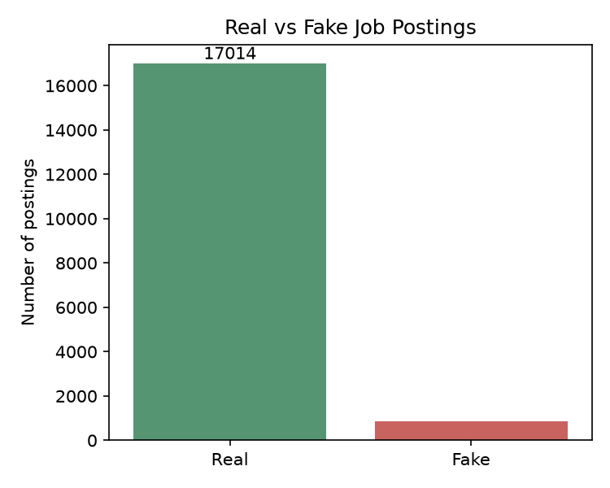
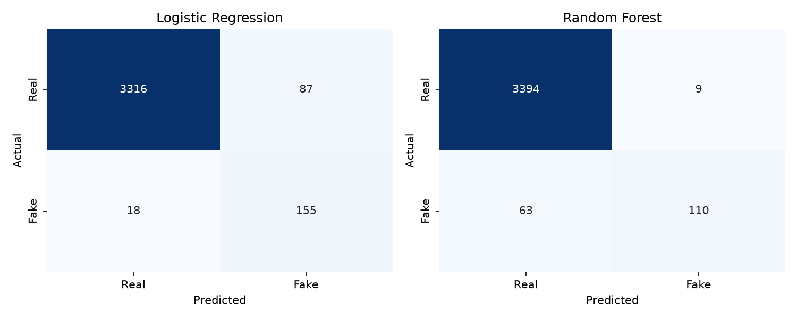
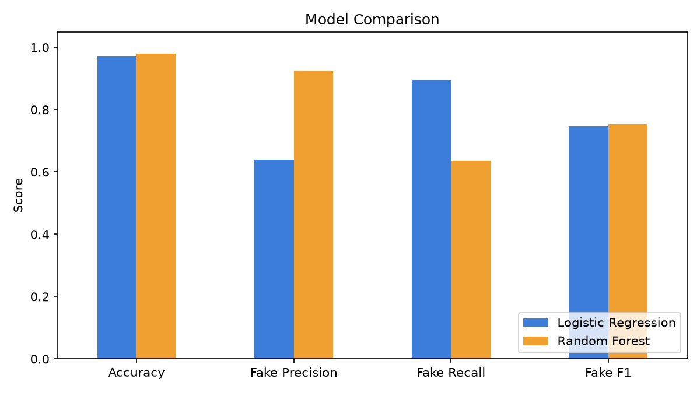
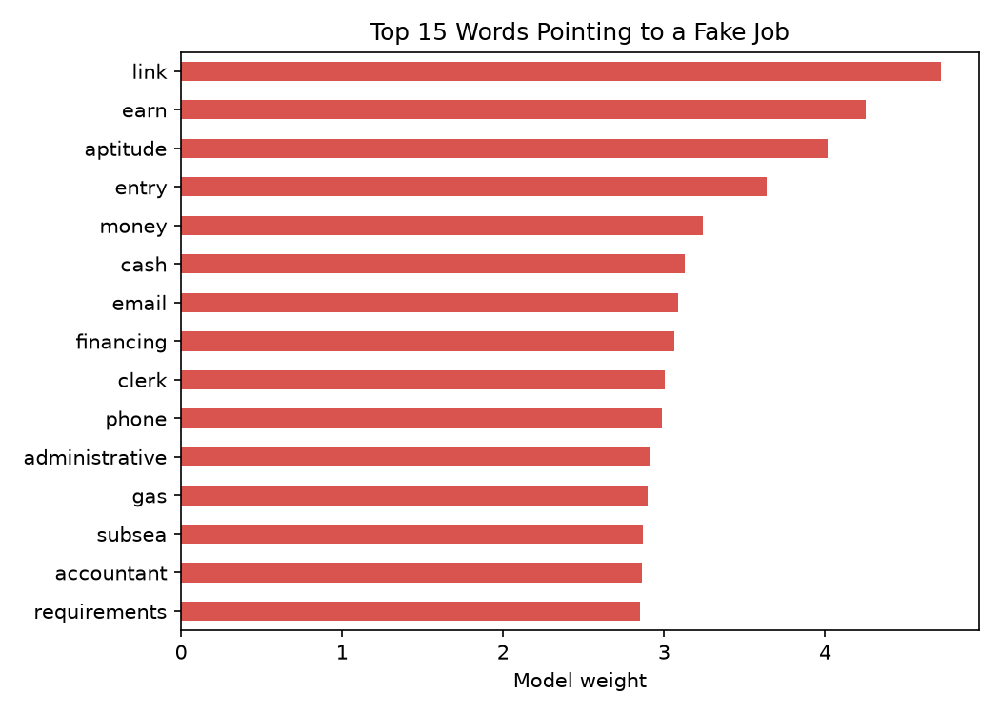

# Fake Job Posting Detector

A machine learning project that predicts whether a job posting is **real or fake** from its text. It includes a simple Streamlit web app.

## Dataset
Real or Fake Job Posting Prediction (Kaggle): 17,880 postings, only 866 (about 5%) are fake.

## Approach
1. Combined title, company profile, description, requirements and benefits into one text field
2. Cleaned the text (lowercase, removed symbols)
3. Converted text to numbers with TF-IDF (5,000 features)
4. Trained Logistic Regression and Random Forest
5. Built a Streamlit app using Logistic Regression

## Results

| Metric | Logistic Regression | Random Forest |
|---|---|---|
| Accuracy | 0.9706 | 0.9799 |
| Fake Precision | 0.6405 | 0.9244 |
| Fake Recall | 0.8960 | 0.6358 |
| Fake F1 | 0.7470 | 0.7534 |

Logistic Regression was used in the app because it catches more fake jobs (higher recall).

## Charts





## How to run
```
pip install -r requirements.txt
streamlit run app.py
```

## Tech stack
Python, pandas, scikit-learn, matplotlib, seaborn, Streamlit

## Author
Yasmeen Khan